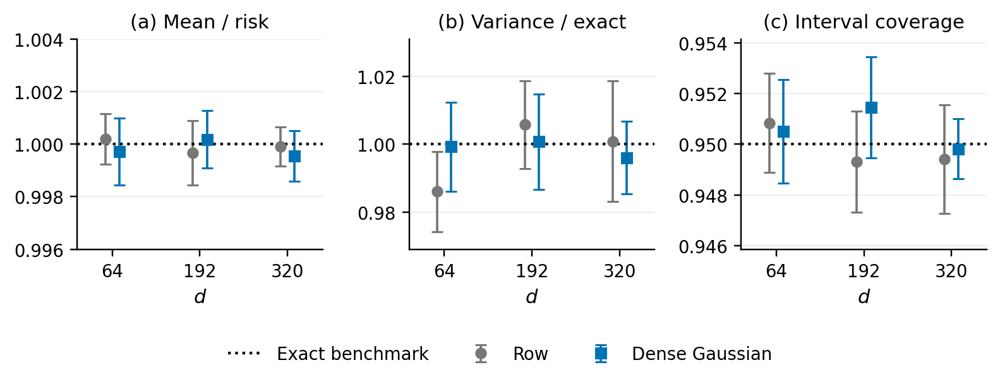

# Complementary risk estimate: conditional calibration

**Status: complete.**

Six settings use n=256, m=128, d in {64,192,320}, and row or raw dense Gaussian sketches. Each setting has 20 independent frozen fitted summaries and 3,000 complementary-data draws per summary. The run retains 360,000 planned draws, including 0 failures.

Features have AR(1) covariance Sigma[j,k]=0.5^|j-k|; Gaussian noise has variance one. The common deterministic sparse coefficient vector is normalized to beta' Sigma beta=4.

We freeze S, QX, and Qepsilon, where Q=(SS')^(-1/2)S. For each draw we generate all independent Gaussian feature coordinates and noise in the n-m complementary directions. This generates conditional linear-model data, rather than sampling a chi-square law. The fit solves the raw compressed equations SX and Sy by least squares when d<m and by the minimum-norm solution when d>m. The raw dense sketch has independent N(0,1/m) entries.

The complementary risk estimate is ||Q_perp(y-X beta_hat)||^2/(n-m) in every setting. For d<m, the full residual also contains the frozen row-space residual; that contribution is recorded separately and is excluded from this estimate. True response prediction risk is R=1+(beta_hat-beta)' Sigma (beta_hat-beta). The exact 95% interval for R is [SSE/chi2_(n-m,.975), SSE/chi2_(n-m,.025)].

The figure reports the mean estimate/R, the conditional sample variance of estimate/R divided by 2/(n-m), and coverage. Targets are 1, 1, and 0.95. First compute each metric within a frozen summary, then average over summaries. Pointwise 95% Monte Carlo intervals use Student t with 19 degrees of freedom across those independent clusters. The inner draws are not treated as independent training fits. No failed problem is redrawn or trimmed; any incomplete setting has missing inferential summaries.

| Sketch | d | Mean / risk (95% MC interval) | Variance / exact (95% MC interval) | Coverage (95% MC interval) |
|---|---:|---:|---:|---:|
| Dense Gaussian | 64 | 0.9997 [0.9985, 1.0010] | 0.9993 [0.9862, 1.0125] | 0.9505 [0.9485, 0.9526] |
| Row | 64 | 1.0002 [0.9992, 1.0012] | 0.9860 [0.9742, 0.9979] | 0.9508 [0.9489, 0.9528] |
| Dense Gaussian | 192 | 1.0002 [0.9991, 1.0013] | 1.0008 [0.9867, 1.0148] | 0.9514 [0.9495, 0.9534] |
| Row | 192 | 0.9997 [0.9985, 1.0009] | 1.0058 [0.9928, 1.0188] | 0.9493 [0.9473, 0.9513] |
| Dense Gaussian | 320 | 0.9995 [0.9986, 1.0005] | 0.9961 [0.9854, 1.0068] | 0.9498 [0.9486, 0.9510] |
| Row | 320 | 0.9999 [0.9992, 1.0007] | 1.0009 [0.9832, 1.0187] | 0.9494 [0.9473, 0.9516] |

For the first complementary draw of each frozen summary, reconstructing the full data preserves the compressed summaries, refitted coefficients, and complementary and full residuals to a maximum relative discrepancy of 6.21e-15. This audit does not assume interpolation.

Outputs: [raw draws](raw.csv.gz), [per-frozen-fit summaries](frozen_summaries.csv), [setting summaries](settings.csv), [frozen artifacts and diagnostics](frozen_diagnostics.csv), [failures](failures.csv), and [provenance](metadata.json). Each frozen NPZ stores S, the orthogonal decomposition, compressed data, coefficients, and exact risk; its SHA-256 hash is in the diagnostics file.
