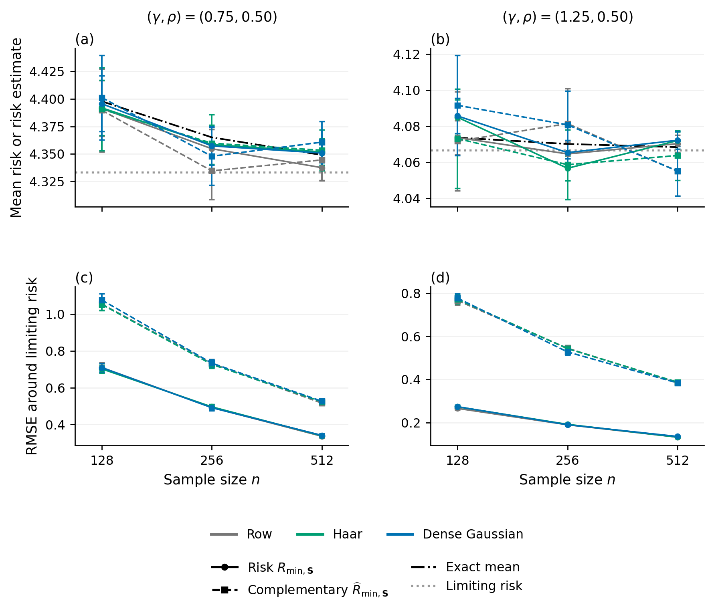

# Supplementary isotropic minimum-norm benchmarks

Master seed: 2026092701. Repetitions per setting: 3,000. Attempted fits: 54,000; numerical failures: 0.

The 18 settings cross n=128,256,512; (d/n,m/n)=(0.75,0.50),(1.25,0.50); and row, Haar, and raw dense Gaussian sketches. Features and errors are independent standard Gaussian variables. The covariance is deliberately the identity, as required by the isotropic minimum-norm benchmark theorem. The fixed coefficient vector has its first min(10,d) coordinates equal and squared Euclidean norm four.

Each repetition generates an original X and y=X beta+epsilon. The three sketch families share these data and use independently keyed sketch streams, independent of the data. Row and Haar sketches have orthogonal rows of length sqrt(n/m); the dense Gaussian sketch has independent N(0,1/m) entries. The raw compressed equations are solved by a minimum-norm QR solve, with no ridge or whitening. The Gaussian law of a scalar risk or pivot is never used to generate observations.

Exact response risk is R=1+||beta_hat-beta||^2. All fits interpolate the compressed equations, so the complementary risk estimate is ||y-X beta_hat||^2/(n-m). Conventional GCV is [||y-X beta_hat||^2/n]/(1-m/n)^2. Its exact multiplicative inflation relative to the complementary estimate is 1/(1-m/n).

The exact mean risk is 1+4(1-m/d)+m/(d-m-1). The limiting risk is 4(1-rho/gamma)+gamma/(gamma-rho), where gamma=d/n and rho=m/n. The complementary estimate has the same exact mean and limit. GCV has exact mean and limiting value larger by 1/(1-rho); these quantities are archived, but GCV is omitted from the figure to keep the other curves readable.

The upper panels compare empirical means with the exact finite-sample mean and proportional limit. The lower panels report RMSE of the realized risk and complementary estimate around that deterministic limit. These are concentration errors, distinct from estimating the risk of an individual fitted model. The archive separately records each risk estimate's bias and MAE relative to its own fit's realized risk.

Monte Carlo standard errors for means, biases, and MAEs are sample standard deviations (denominator repetitions-1) divided by sqrt(repetitions). For a concentration RMSE, the delta-method standard error is the standard error of the mean squared deviation divided by twice the RMSE. Bars and archived intervals use 1.96 standard errors and are pointwise normal approximations. The three families are paired through their data; results across families are not independent replications.

All 54,000 fits completed without replacements or trimming. The largest relative compressed-interpolation diagnostic is 1.711e-15. An SVD rank diagnostic was also performed on the prespecified first repetition in every setting, without changing the QR estimator.

| n | d/n | Sketch | Mean R (MCSE) | Mean complementary (MCSE) | Mean GCV (MCSE) | Exact mean R | Limiting R |
|---:|---:|---|---:|---:|---:|---:|---:|
| 128 | 0.75 | Dense Gaussian | 4.3957 (0.0129) | 4.4013 (0.0196) | 8.8025 (0.0393) | 4.3978 | 4.3333 |
| 128 | 0.75 | Haar | 4.3919 (0.0128) | 4.3907 (0.0192) | 8.7815 (0.0384) | 4.3978 | 4.3333 |
| 128 | 0.75 | Row | 4.3913 (0.0129) | 4.3897 (0.0192) | 8.7793 (0.0385) | 4.3978 | 4.3333 |
| 256 | 0.75 | Dense Gaussian | 4.3573 (0.0090) | 4.3479 (0.0134) | 8.6959 (0.0268) | 4.3651 | 4.3333 |
| 256 | 0.75 | Haar | 4.3585 (0.0090) | 4.3597 (0.0133) | 8.7195 (0.0265) | 4.3651 | 4.3333 |
| 256 | 0.75 | Row | 4.3547 (0.0090) | 4.3346 (0.0134) | 8.6693 (0.0267) | 4.3651 | 4.3333 |
| 512 | 0.75 | Dense Gaussian | 4.3509 (0.0062) | 4.3608 (0.0096) | 8.7215 (0.0192) | 4.3491 | 4.3333 |
| 512 | 0.75 | Haar | 4.3519 (0.0062) | 4.3534 (0.0095) | 8.7067 (0.0191) | 4.3491 | 4.3333 |
| 512 | 0.75 | Row | 4.3375 (0.0061) | 4.3446 (0.0094) | 8.6892 (0.0188) | 4.3491 | 4.3333 |
| 128 | 1.25 | Dense Gaussian | 4.0857 (0.0050) | 4.0916 (0.0142) | 8.1833 (0.0284) | 4.0737 | 4.0667 |
| 128 | 1.25 | Haar | 4.0850 (0.0050) | 4.0732 (0.0141) | 8.1463 (0.0282) | 4.0737 | 4.0667 |
| 128 | 1.25 | Row | 4.0737 (0.0049) | 4.0717 (0.0140) | 8.1434 (0.0280) | 4.0737 | 4.0667 |
| 256 | 1.25 | Dense Gaussian | 4.0654 (0.0035) | 4.0808 (0.0096) | 8.1616 (0.0193) | 4.0702 | 4.0667 |
| 256 | 1.25 | Haar | 4.0566 (0.0035) | 4.0586 (0.0099) | 8.1173 (0.0198) | 4.0702 | 4.0667 |
| 256 | 1.25 | Row | 4.0646 (0.0035) | 4.0814 (0.0099) | 8.1629 (0.0199) | 4.0702 | 4.0667 |
| 512 | 1.25 | Dense Gaussian | 4.0722 (0.0025) | 4.0551 (0.0070) | 8.1102 (0.0140) | 4.0684 | 4.0667 |
| 512 | 1.25 | Haar | 4.0721 (0.0024) | 4.0637 (0.0071) | 8.1275 (0.0142) | 4.0684 | 4.0667 |
| 512 | 1.25 | Row | 4.0703 (0.0024) | 4.0551 (0.0070) | 8.1102 (0.0140) | 4.0684 | 4.0667 |

Files: [raw draws](raw.csv.gz), [summaries](summary.csv), [failure records](failures.csv), and [metadata](metadata.json).
